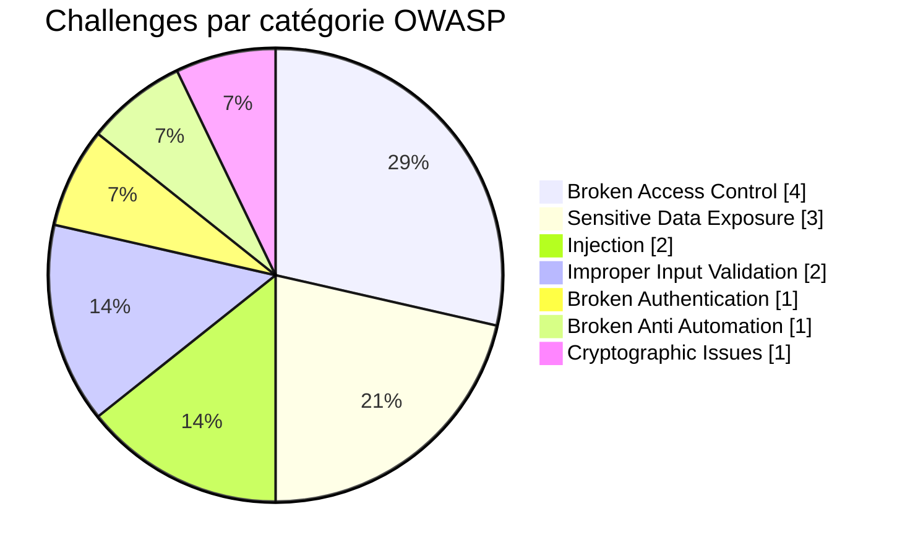

<div align="center">

# 🧃 OWASP Juice Shop — Pentest Reports

**14 challenges résolus · 7 catégories OWASP · un rapport technique par faille**


*Tests d'intrusion sur une application web volontairement vulnérable, documentés pour être reproduits et compris.*

</div>

---

## 🎯 En bref

Projet du module **B-SEC-100 – Hack & Juice** (Bachelor Epitech, Lille).
L'objectif : exploiter des failles de l'**OWASP Top 10** sur [OWASP Juice Shop](https://owasp.org/www-project-juice-shop/),
puis les **documenter comme un vrai rapport de pentest** : étapes de reproduction, CWE, sévérité,
risques et correctifs.

> [!WARNING]
> **Cadre légal.** Toutes les attaques ont été menées sur une instance de Juice Shop, application conçue pour cela.
> Ne testez jamais ces techniques sur un système sans l'autorisation écrite de son propriétaire.

---

## 📊 Vue d'ensemble



| | Difficulté 3 | Difficulté 4 | Total |
|---|:-:|:-:|:-:|
| **Challenges** | 9 | 5 | **14** |

Sévérité estimée : 🔴 **3 critiques** · 🟠 **6 élevées** · 🟡 **4 moyennes** · 🟢 **1 faible**

---

## 🗂️ Les challenges

| Catégorie | Challenge | Diff. | CWE | Sévérité |
|---|---|:-:|---|:-:|
| 💉 **Injection** | [Login Jim](Injection/Injection-3-Login%20Jim.md) | ⭐⭐⭐ | CWE-89 | 🟠 Élevée |
| | [Login Bender](Injection/Injection-3-Login%20Bender.md) | ⭐⭐⭐ | CWE-89 | 🟠 Élevée |
| 🔓 **Broken Access Control** | [Forged Feedback](Broken%20Access%20Control/Broken%20Access%20Control-3-Forged%20Feedback.md) | ⭐⭐⭐ | CWE-284 | 🟡 Moyenne |
| | [Forged Review](Broken%20Access%20Control/Broken%20Access%20Control-3-Forged%20Review.md) | ⭐⭐⭐ | CWE-284 | 🟡 Moyenne |
| | [Manipulate Basket](Broken%20Access%20Control/Broken%20Access%20Control-3-Manipulate%20Basket.md) | ⭐⭐⭐ | CWE-284 | 🟠 Élevée |
| | [Easter Egg](Broken%20Access%20Control/Broken%20Access%20Control-4-Easter%20Egg.md) | ⭐⭐⭐⭐ | CWE-284 | 🟢 Faible |
| 🔑 **Broken Authentication** | [Bjoern's Favorite Pet](Broken%20Authentication/Broken%20Authentication-3-Bjoern's%20Favorite%20Pet.md) | ⭐⭐⭐ | CWE-287 | 🟠 Élevée |
| 🤖 **Broken Anti Automation** | [CAPTCHA Bypass](Broken%20Anti%20Automation/Broken%20Anti%20Automation-3-CAPTCHA%20Bypass.md) | ⭐⭐⭐ | CWE-307 | 🟡 Moyenne |
| ⚠️ **Improper Input Validation** | [Payback Time](Improper%20Input%20Validation/Improper%20Input%20Validation-3-Payback%20Time.md) | ⭐⭐⭐ | CWE-20 | 🟠 Élevée |
| | [Poison Null Byte](Improper%20Input%20Validation/Improper%20Input%20Validation-4-Poison%20Null%20Byte.md) | ⭐⭐⭐⭐ | CWE-20 / 158 | 🔴 Critique |
| 🔐 **Cryptographic Issues** | [Nested Easter Egg](Cryptographic%20Issues/Cryptographic%20Issues-4-Nested%20Easter%20Egg.md) | ⭐⭐⭐⭐ | CWE-310 | 🟡 Moyenne |
| 📂 **Sensitive Data Exposure** | [Login Amy](Sensitive%20Data%20Exposure/Sensitive%20Data%20Exposure-3-Login%20Amy.md) | ⭐⭐⭐ | CWE-522 | 🟠 Élevée |
| | [Forgotten Developer Backup](Sensitive%20Data%20Exposure/Sensitive%20Data%20Exposure-4-Forgotten%20Developer%20Backup.md) | ⭐⭐⭐⭐ | CWE-200 | 🔴 Critique |
| | [Forgotten Sales Backup](Sensitive%20Data%20Exposure/Sensitive%20Data%20Exposure-4-Forgotten%20Sales%20Backup.md) | ⭐⭐⭐⭐ | CWE-200 | 🔴 Critique |

---

## 🧪 Exemple : Login Jim (injection SQL)

Se connecter au compte de Jim **sans connaître son mot de passe**.

1. Récupérer l'e-mail de Jim dans l'avis d'un produit.
2. Dans Burp Suite, intercepter la requête de connexion.
3. Ajouter `'--` juste après l'e-mail.

```json
{ "email": "jim@juice-sh.op'--", "password": "abcd" }
```

`'` ferme la chaîne dans la requête SQL et `--` met en commentaire tout le reste, donc le test
du mot de passe n'est jamais exécuté. **Correctif :** requêtes paramétrées, jamais de concaténation.
Rapport complet : [Login Jim](Injection/Injection-3-Login%20Jim.md).

---

## 🧰 Compétences mises en pratique

| Domaine | Détail |
|---|---|
| **Interception HTTP** | Burp Suite : Proxy, Repeater, modification de requêtes à la volée |
| **Injection** | Contournement d'authentification par injection SQL |
| **Contrôle d'accès** | Manipulation d'identifiants (`UserId`, `BasketId`) pour agir au nom d'autrui |
| **Validation des entrées** | Valeurs négatives, null byte (`%00`) |
| **Reconnaissance** | OSINT, analyse d'une application, découverte de fichiers oubliés |
| **Rédaction** | CWE, sévérité, risques, mesures d'atténuation et de correction |

<details>
<summary><b>📝 Anatomie d'un rapport</b></summary>

<br>

Chaque fichier suit le même modèle :

1. **Description** : l'énoncé du challenge et la faille mise en évidence
2. **Méthodologie** : étapes numérotées pour reproduire l'attaque, techniques et outils
3. **Vulnérabilités** : type, CWE, composants affectés, sévérité estimée
4. **Risques** : l'impact possible pour l'entreprise
5. **Actions** : atténuation, correction et bonnes pratiques

</details>

---

## ▶️ Reproduire les attaques

```bash
docker run --rm -p 3000:3000 bkimminich/juice-shop
```

Ouvrir http://localhost:3000, configurer le navigateur pour passer par le proxy de Burp Suite
(par défaut `127.0.0.1:8080`), puis suivre les étapes d'un rapport.

## 📁 Structure

Un dossier par catégorie OWASP, un fichier Markdown par challenge. La difficulté
(`-3-` ou `-4-`) est dans le nom du fichier.

```
.
├── Injection/
├── Broken Access Control/
├── Broken Authentication/
├── Broken Anti Automation/
├── Improper Input Validation/
├── Cryptographic Issues/
├── Sensitive Data Exposure/
└── README.md
```

---

<div align="center">

Réalisé par **Loïs-Elie Ekollo** · Bachelor Epitech, spécialité Web, Cloud & Blockchain

</div>
